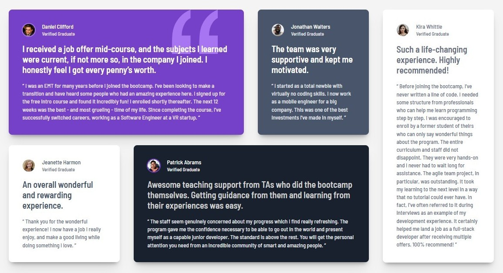

# Frontend Mentor - Testimonials grid section

## Overview

For this challenge, I built and deployed Frontend Mentor's Testimonial Grid Section. They provided all the necessary assets, including the images, a Figma file, and a comprehensive style guide.

[Frontend Mentor Testimonial grid section challenge](https://www.frontendmentor.io/challenges/testimonials-grid-section-Nnw6J7Un7)

This challenge required knowledge of CSS, Grid, semantic HTML, and responsive web design.

### Screenshot

### Links

- Solution URL: [github repository](https://github.com/ClassPython/fem-testimonials-grid-section)
- Live Site URL: [github-pages](https://classpython.github.io/fem-testimonials-grid-section/)

### Built with

- Semantic HTML5 markup
- CSS Grid
- Mobile first design

### What I learned

 - The biggest challenge was rearranging the card order while dynamically updating each card's size.
- This was solved by utilizing CSS Grid, display: contents, and media queries.
- CSS Grid allowed for the precise placement of cards within designated containers.
- display: contents effectively allowed for the removal or appearance of containers in the layout while leaving their child cards fully intact in the DOM.
- Media queries enabled dynamic control of display: contents and the grid layout to reposition cards based on screen size.

 ### Next Steps

- Complete the final project under the Frontend Mentor 'Building Responsive Websites' learning path.
 

